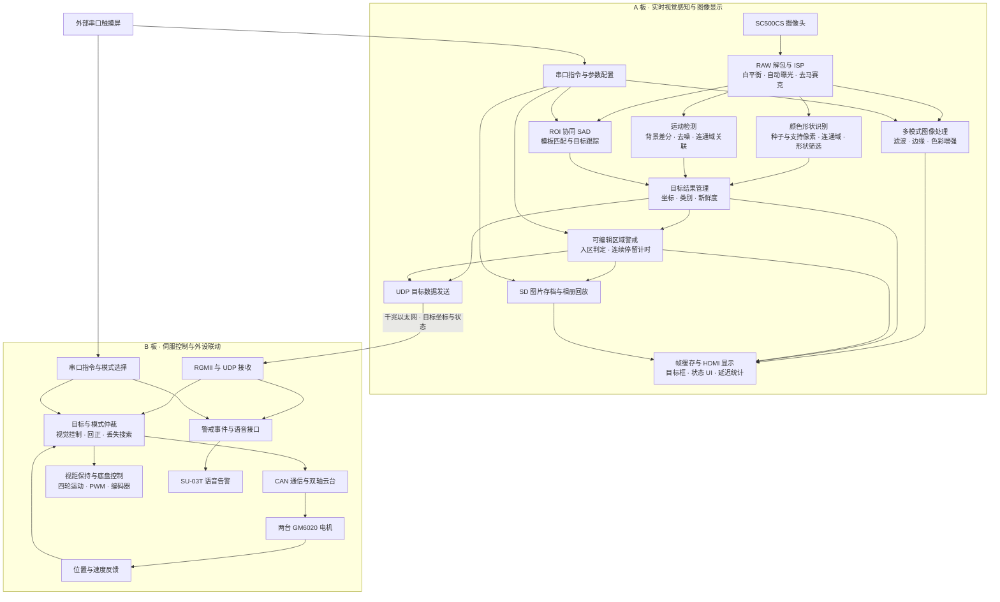

# 双 FPGA 实时视觉伺服系统

本项目采用双 FPGA 协同架构，融合实时图像处理、目标识别、区域警戒与伺服跟踪，构建“感知—决策—通信—控制—反馈”的完整信息通路。A 板完成摄像头采集、ISP、多模式图像处理、红蓝规则目标与运动检测、ROI 协同 SAD 跟踪、图片存档和 HDMI 状态显示；B 板通过千兆以太网接收目标记录，协调 GM6020 双轴云台、移动底盘和语音告警。

外部串口触摸屏统一下发模式与参数指令，支持警戒区域编辑、不同速度档位跟踪、视距保持及相册操作。系统结合目标新鲜度管理、编码器反馈与模式仲裁，实现图像感知和运动执行的协同，并通过 OSD 展示目标坐标、警戒状态及数字链路延迟。

源码覆盖双板生产 RTL、系统顶层、工程配置和约束。识别链采用强颜色种子与支持像素、空间筛选、形状资格和帧级结果发布；运动链结合灰度块采样、背景差分、去噪与连通域关联。ROI 协同 SAD 完成模板采集、候选搜索、评分、学习与恢复；B 板结合几何映射、模型控制、反馈与模式仲裁组织执行链路。

## 工程组成

| 部分 | 内容 |
|---|---|
| 摄像头与 ISP | RAW 解包、传感器配置、黑电平、白平衡、自动曝光、数字增益、去马赛克等可读源码 |
| 通用图像处理 | 灰度、二值化、直方图拉伸、Sobel、高斯滤波、伽马、伪彩、卡通化、饱和度与对比度 |
| 视频与显示 | 视频输入/输出、缓存仲裁接口、打框叠加、字库、模式 UI、透明 OSD 及内部延迟统计 |
| 板间通信 | UART 指令、UDP 组包与接收、RGMII、MDIO、PHY 控制、跨域 FIFO 与复位同步 |
| 警戒与存档框架 | 区域编辑、事件计时、告警显示、SD 原始扇区读写、照片管理与相册 UI |
| B 板通用接口 | GM6020 CAN 通信驱动、基础 PWM、底盘运动解算、编码器采集、串口命令与语音接口 |
| 颜色形状识别 | 红蓝颜色判定、强种子与支持像素、连通域、面积与轮廓资格、中心坐标和帧级结果发布 |
| 运动目标检测 | 灰度块采样、背景差分、增益变化稳定等待、邻域去噪、连通域合并与双目标关联 |
| 基础闭环控制 | 通用 PID、单轴定点视觉 PID、双轴封装、积分与输出限幅、无效目标及通信超时资格 |
| ROI 协同 SAD | 模板采集、候选搜索、评分与接受、模板更新、锚点恢复及存储交互 |
| 云台与底盘控制 | 视觉几何映射、双轴模型控制、上电回零、目标丢失搜索、回正与视距保持 |
| 工程与配置 | 双板顶层、TD 工程、IP 配置、引脚与时序约束，以及 SAD、运动检测和伺服控制的示例调校配置 |
| 模块接口 | 端口方向、声明位宽与信号名称，方便核对模块连接 |

文件清单见 [PUBLIC_SCOPE.json](PUBLIC_SCOPE.json)，工程入口和依赖见 [集成说明](docs/INTEGRATION.md)，应用配置见 [参数配置](docs/CONFIGURATION.md)。各模块保留原有版权和组件说明。

## 系统通路



该图按 A 板视觉处理、B 板执行控制分层展示系统职责和主要信息方向；各链路的时钟域、缓冲与握手应结合具体接口核对。

## 检测与基础控制源码

| 模块 | 主要实现 |
|---|---|
| [yanseshibie.v](A_board/lab_ex3_osd/user_source/hdl_source/yanseshibie.v) | RGB 颜色证据、暗色支持、空间采样、红蓝目标分类与中心坐标 |
| [color_ccl_pipeline.v](A_board/lab_ex3_osd/user_source/hdl_source/color_ccl_pipeline.v) | 行游程与组件累计、强种子资格、包围框、填充及轮廓条件、时间确认 |
| [color_control_detect.v](A_board/lab_ex3_osd/user_source/hdl_source/color_control_detect.v) | 四像素输入观察、帧完整性检查、控制结果发布、显示帧身份匹配与跨域传递 |
| [zhencha_multi_ccl.v](A_board/lab_ex3_osd/user_source/hdl_source/zhencha_multi_ccl.v) | 灰度块、背景更新、差分、邻域投票与闭运算、连通域及双目标管理 |
| [zhencha_shibie.v](A_board/lab_ex3_osd/user_source/hdl_source/zhencha_shibie.v) | 单目标差分观察与包围框提取，作为独立模块使用 |
| [pid_ctrl.v](B_board/GM6020_test/user_source/pid_ctrl.v) | 通用定点 PID、可选采样触发、前馈与限幅 |
| [vision_axis_pid.v](B_board/GM6020_test/user_source/vision_axis_pid.v) | 单轴坐标误差、死区、积分约束、测量微分与低通滤波、分阶段提交 |
| [vision_xy_pid.v](B_board/GM6020_test/user_source/vision_xy_pid.v) | 双轴实例组织、坐标范围与通信超时判定、控制有效信号 |
| [a38_sad16_core.v](A_board/lab_ex3_osd/user_source/hdl_source/mode38_local/a38_sad16_core.v) | ROI 协同 SAD 搜索、姿态候选、评分、学习与恢复的完整核心通路 |
| [a38_sad16_capture.v](A_board/lab_ex3_osd/user_source/hdl_source/mode38_local/a38_sad16_capture.v) | 模板与图像采集、作业提交及匹配结果组织 |
| [a38_local_control.v](A_board/lab_ex3_osd/user_source/hdl_source/mode38_local/a38_local_control.v) | 指令、目标跟踪、警戒与模板存储的模式协调 |
| [vision_geometry_map.v](B_board/GM6020_test/user_source/vision_geometry_map.v) | 定点多项式映射、局部雅可比及边界延伸 |
| [vision_nonlinear_ctrl.v](B_board/GM6020_test/user_source/vision_nonlinear_ctrl.v) | 目标与反馈管理、预测、几何转换和控制目标发布 |
| [GM6020_id2_model_ctrl.v](B_board/GM6020_test/user_source/GM6020_id2_model_ctrl.v) | 单/双轴模型控制、反馈处理、控制档位与输出限制 |
| [top.v](B_board/GM6020_test/user_source/top.v) | 云台、底盘、回零、搜索、视距与语音等完整控制集成 |

识别和运动模块分别组织数据通路，基础 PID 可用于兼容接口的控制应用。各模块的输入格式、参数含义、RAM 依赖和编译方式见[集成说明](docs/INTEGRATION.md)。

## 目录

```text
A_board/lab_ex3_osd/
  td_project/                    A 板 TD 工程与时序入口
  user_source/
    hdl_source/                  采集、ISP、检测、SAD、显示、通信和 SD
      fpga_motion_example_config.vh  运动检测应用配置
      mode38_local/              ROI/SAD 实现与应用配置
    ip_source/                   RAM、PLL 等 IP 配置及包装
    constraints_source/          引脚与时序约束
B_board/GM6020_test/
  GM6020.al                      B 板 TD 工程
  GM6020_route_fixed.al          含时序登记的备用工程入口
  user_source/                   视觉控制、模型、PID、CAN、底盘及 Ethernet
    fpga_b_example_config.vh      应用配置
  al_ip/                         CAN 与 PLL 组件
  io_config.adc                  B 板引脚配置
  timing.sdc                     B 板时序约束
interfaces/
  A_board/                       A 板模块接口说明
  B_board/                       B 板模块接口说明
docs/
  INTEGRATION.md                 工程入口、依赖与使用条件
  CONFIGURATION.md               调校参数和配置方法
PUBLIC_SCOPE.json                文件范围与模块清单
```

## 使用与验证范围

参考平台为 **PH1P35MDG324，速度等级 -3，Tang Dynasty 6.2.168116**。摄像头参考配置为 1280×720；实际帧率、像素格式、时钟与功能资格以相应源码为准。

构建前请按 [集成说明](docs/INTEGRATION.md) 配置模块、厂商 IP、工程清单、时钟和接口约束，并逐项检查代码注释中的使用条件。`interfaces/` 中的 JSON 用于接口索引，不参与 HDL 编译。

应用调校使用集中管理的示例配置，接入实际相机与执行机构后需自行核对标定、增益和限幅。源码结构及工程依赖检查与算法效果、系统时序属于不同验证阶段，本次未重新综合、布局布线或上板验证。内部延迟统计仅覆盖其定义的数字链路起止事件，不包含显示屏面板响应时间。

## FPGA 工程 skill

独立公开的 [FPGA RTL Engineer Skill](https://github.com/cz666GOUTOU/fpga-rtl-engineer-skill) 提供工程审查、时序、资源和验证方面的通用方法，与本仓库分开维护。

## 版权与使用

请阅读 [NOTICE.md](NOTICE.md)。公开可读不改变原有第三方代码和 IP 的版权或许可；本仓库没有将厂商组件改授为统一开源许可。
