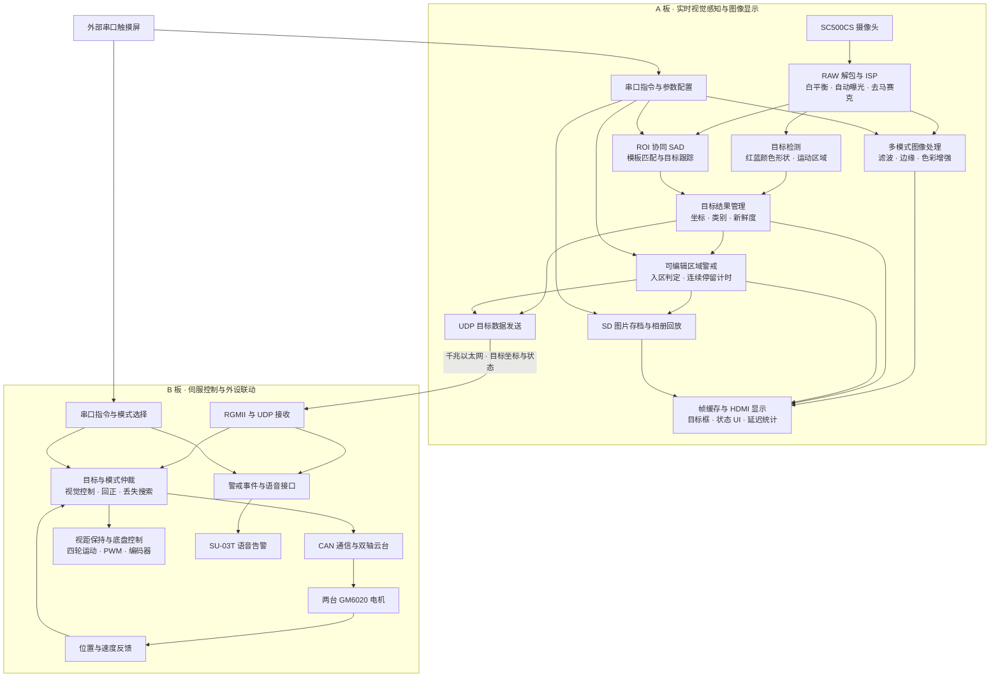

# 双 FPGA 实时视觉伺服系统

本项目采用双 FPGA 协同架构，融合实时图像处理、目标识别、区域警戒与伺服跟踪，构建“感知—决策—通信—控制—反馈”的完整信息通路。A 板完成摄像头采集、ISP、多模式图像处理、红蓝规则目标与运动检测、ROI 协同 SAD 跟踪、图片存档和 HDMI 状态显示；B 板通过千兆以太网接收目标记录，协调 GM6020 双轴云台、移动底盘和语音告警。

外部串口触摸屏统一下发模式与参数指令，支持警戒区域编辑、不同速度档位跟踪、视距保持及相册操作。系统结合目标新鲜度管理、编码器反馈与模式仲裁，实现图像感知和运动执行的协同，并通过 OSD 展示目标坐标、警戒状态及数字链路延迟。

## 工程组成

| 部分 | 内容 |
|---|---|
| 摄像头与 ISP | RAW 解包、传感器配置、黑电平、白平衡、自动曝光、数字增益、去马赛克等可读源码 |
| 通用图像处理 | 灰度、二值化、直方图拉伸、Sobel、高斯滤波、伽马、伪彩、卡通化、饱和度与对比度 |
| 视频与显示 | 视频输入/输出、缓存仲裁接口、打框叠加、字库、模式 UI、透明 OSD 及内部延迟统计 |
| 板间通信 | UART 指令、UDP 组包与接收、RGMII、MDIO、PHY 控制、跨域 FIFO 与复位同步 |
| 警戒与存档框架 | 区域编辑、事件计时、告警显示、SD 原始扇区读写、照片管理与相册 UI |
| B 板通用接口 | GM6020 CAN 通信驱动、基础 PWM、底盘运动解算、编码器采集、串口命令与语音接口 |
| 模块接口 | 端口声明与参数名称，用于说明视觉处理和控制模块的集成边界 |

文件清单见 [PUBLIC_SCOPE.json](PUBLIC_SCOPE.json)，模块依赖与集成条件见 [集成说明](docs/INTEGRATION.md)。通用模块保留原有源码和版权注释，独立 UART、反馈与语音模块集中在 `public_helpers/`。

## 系统通路



该图按 A 板视觉处理、B 板执行控制分层展示系统职责和主要信息方向；各链路的时钟域、缓冲与握手应结合具体接口核对。

## 目录

```text
A_board/lab_ex3_osd/user_source/
  hdl_source/                     采集、ISP、通用图像、显示、通信和 SD 框架
  constraints_source/pin.adc      A 板引脚配置快照
B_board/GM6020_test/
  user_source/                   CAN、PWM、底盘通用接口及 Ethernet
    public_helpers/              拆出的串口、反馈与语音模块
  io_config.adc                  B 板引脚配置快照
interfaces/
  A_board/                       A 板模块接口说明
  B_board/                       B 板模块接口说明
docs/
  INTEGRATION.md                 集成边界与使用条件
PUBLIC_SCOPE.json                文件范围与模块清单
```

## 使用与验证范围

参考平台为 **PH1P35MDG324，速度等级 -3，Tang Dynasty 6.2.168116**。摄像头参考配置为 1280×720；实际帧率、像素格式、时钟与功能资格以相应源码为准。

构建前请按 [集成说明](docs/INTEGRATION.md) 补齐模块实现和所需厂商 IP，并建立与实际硬件一致的工程清单、时钟和接口约束。`interfaces/` 中的 JSON 用于接口描述，不是可执行 HDL。

本次发布完成文件与文档检查，未重新综合、布局布线或上板验证。内部延迟统计仅覆盖其定义的数字链路起止事件，不包含显示屏面板响应时间。

## FPGA 工程 skill

独立公开的 [FPGA RTL Engineer Skill](https://github.com/cz666GOUTOU/fpga-rtl-engineer-skill) 提供工程审查、时序、资源和验证方面的通用方法，与本仓库分开维护。

## 版权与使用

请阅读 [NOTICE.md](NOTICE.md)。公开可读不改变原有第三方代码和 IP 的版权或许可；本仓库没有将厂商组件改授为统一开源许可。
