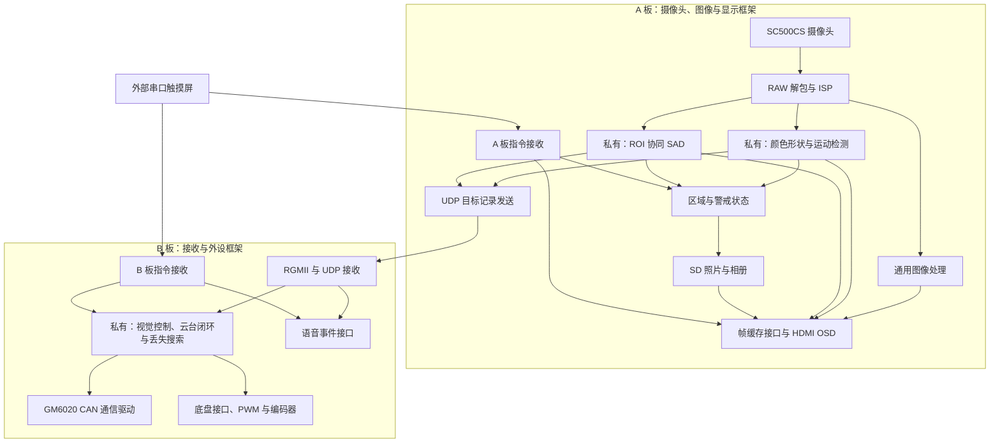

# 双 FPGA 视觉伺服系统 · 公开框架版

本仓库公开双 FPGA 视觉系统的采集、图像处理、显示、通信、存储和交互框架。系统由 A 板承担摄像头与视频处理，B 板承担数据接收及外设接口，外部串口触摸屏发送模式与参数指令，两板通过千兆以太网交换目标记录。

**本仓库采用部分源码公开方式。目标识别、模板跟踪、运动检测、云台闭环控制及丢失搜索的内部实现不在公开范围内。** 完整工程独立保存在私有仓库；本仓库从经过筛选的快照重新建立，未导入完整工程的 Git 历史。

## 公开内容

| 部分 | 内容 |
|---|---|
| 摄像头与 ISP | RAW 解包、传感器配置、黑电平、白平衡、自动曝光、数字增益、去马赛克等可读源码 |
| 通用图像处理 | 灰度、二值化、直方图拉伸、Sobel、高斯滤波、伽马、伪彩、卡通化、饱和度与对比度 |
| 视频与显示 | 视频输入/输出、缓存仲裁接口、打框叠加、字库、模式 UI、透明 OSD 及内部延迟统计 |
| 板间通信 | UART 指令、UDP 组包与接收、RGMII、MDIO、PHY 控制、跨域 FIFO 与复位同步 |
| 警戒与存档框架 | 区域编辑、事件计时、告警显示、SD 原始扇区读写、照片管理与相册 UI |
| B 板通用接口 | GM6020 CAN 通信驱动、基础 PWM、底盘运动解算、编码器采集、串口命令与语音接口 |
| 核心接口 | 私有模块的端口声明及参数名称，方便了解集成边界；不含参数调校值和算法实现 |

公开文件清单见 [PUBLIC_SCOPE.json](PUBLIC_SCOPE.json)。通用模块保留原有源码和版权注释，8 个独立 UART/反馈/语音模块从混合顶层文件中拆出，未公开该顶层的控制实现。

## 未公开的核心

- **颜色与形状识别**：颜色分割资格、形状统计、连通域筛选、定位与结果确认的内部实现。
- **运动目标检测**：帧差/背景差、运动连通域及候选目标处理的内部实现。
- **ROI 协同 SAD 跟踪**：模板捕获、搜索、评分、更新与恢复，以及配套计算和控制实现。
- **云台与视觉控制**：几何映射、跟踪控制律、位置/模型控制、相关 PID、启动与回正协调、目标丢失搜索。
- **混合顶层实现**：A/B 顶层内部含有算法配置和控制逻辑，因此仅提供接口说明，系统模块关系通过文档展示。
- **历史与生成物**：不包含完整工程旧提交、测试参考实现、历史副本、仿真脚本、波形、网表、bitstream 或私人工程交接资料。

## 系统通路



该图说明完整系统中的模块职责和主要信息方向，私有核心仍是系统依赖，不表示所有连线对应同一时钟域或一拍直连。

## 目录

```text
A_board/lab_ex3_osd/user_source/
  hdl_source/                     采集、ISP、通用图像、显示、通信和 SD 框架
  constraints_source/pin.adc      A 板引脚配置快照
B_board/GM6020_test/
  user_source/                   CAN、PWM、底盘通用接口及 Ethernet
    public_helpers/              拆出的串口、反馈与语音模块
  io_config.adc                  B 板引脚配置快照
interfaces/
  A_board/                       A 板私有模块接口 JSON
  B_board/                       B 板私有模块接口 JSON
docs/
  INTEGRATION.md                 集成边界与使用条件
PUBLIC_SCOPE.json                明确的公开与隐藏清单
```

## 使用与验证范围

参考平台为 **PH1P35MDG324，速度等级 -3，Tang Dynasty 6.2.168116**。摄像头参考配置为 1280×720；实际帧率、像素格式、时钟与功能资格以相应源码为准。

**公开框架版不是开箱即用的完整工程。** JSON 接口文件只描述端口和参数名称，没有实现，也不是可执行的 HDL 黑盒。使用者需要自行提供兼容核心，取得所需厂商 IP，再建立自己的工程清单与约束；不能直接用本仓库生成完整系统的 bitstream。

MIPI、DDR、HDMI、CAN、PLL 和部分 RAM/DSP 实例依赖目标器件及厂商工具。未随本仓库打包厂商加密/生成 IP 和第三方硬件资料，相关接口与依赖见 [集成说明](docs/INTEGRATION.md)。不要将示例引脚配置直接用于不同板卡。

本次只完成源码筛选、接口提取、历史隔离与发布内容检查，未重新综合、布局布线或上板验证。内部延迟统计仅覆盖其定义的数字链路起止事件，不包含显示屏面板响应时间。

## FPGA 工程 skill

独立公开的 [FPGA RTL Engineer Skill](https://github.com/cz666GOUTOU/fpga-rtl-engineer-skill) 提供工程审查、时序、资源和验证方面的通用方法，与本仓库分开维护。

## 版权与使用

请阅读 [NOTICE.md](NOTICE.md)。公开可读不改变原有第三方代码和 IP 的版权或许可；本仓库没有将厂商组件改授为统一开源许可。
